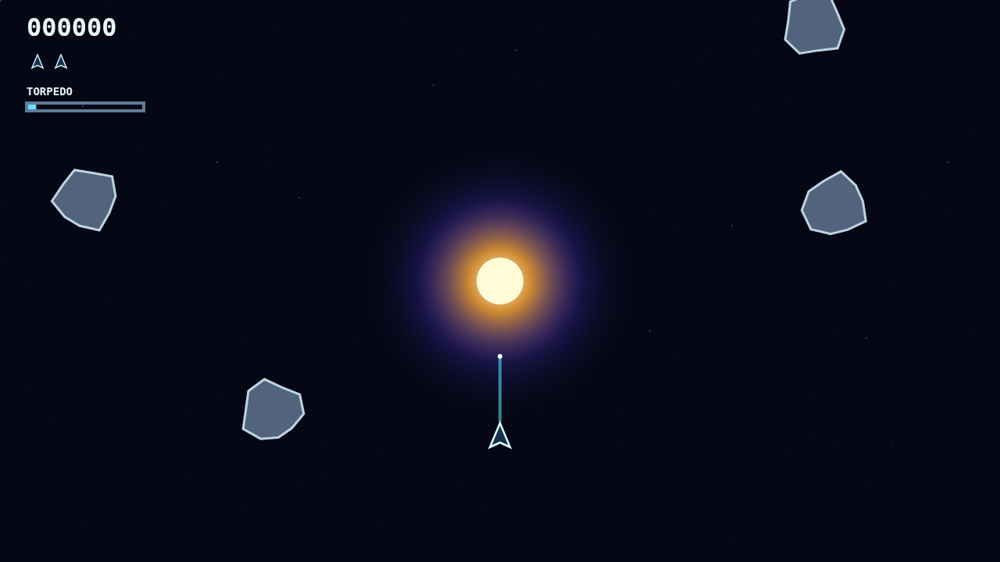

# Bend the impossible shot

Shatter drops you into a restless rock field wrapped around a brilliant gravity well. Your ship keeps pure momentum, but every ordinary shot bends toward the star—turning careful aim into sweeping orbital trick shots.

Large rocks wear armor and burst into two medium fragments; those split again before the field is truly clear. Damage cracks glow across their faces, so you can choose whether to finish a wounded target or escape the growing cloud.

When the angle is hopeless, launch the Warhead: one guided torpedo that ignores gravity, finds the nearest target in its forward cone, and destroys any rock outright. It takes ten long seconds to recharge.

Clear the last fragment and a faster, denser wave follows. Meanwhile, a weaving saucer crosses the field to hunt you—another threat, or another 200 points if you can curve a shot into it.

